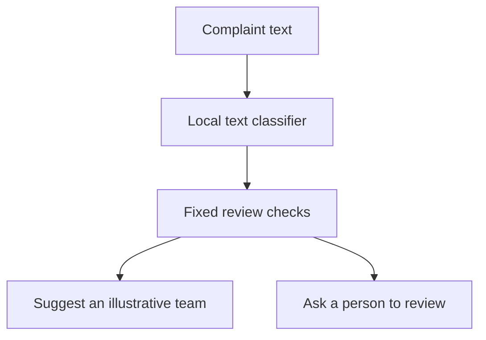

# Complaint Review Assistant
### When should a complaint classifier ask for human review?

A small text analytics study by Juhan Youn: compare suggesting a support team for every complaint with leaving uncertain cases for a person.

**Completed scope:** one local text classifier, fixed Python review rules, an offline comparison and a Streamlit demo. **No LLM, API key or paid inference service is required.**

## What I found

On **1,022 complaints received in May–June 2024**:

| Method | Team suggestions | Human review | Error among suggestions | Wrong suggestions / all cases |
|---|---:|---:|---:|---:|
| Classify every case | 100% | 0% | 13.7% (140/1,022) | 13.7% |
| Use review rules | 85.8% | 14.2% | 7.2% (63/877) | 6.2% |

The rule deferred **77 of the classifier's 140 errors (55%)**. It also deferred **68 cases whose predictions matched the public label**. There is a review-workload trade-off, and a deferred case is not a corrected case.

**Takeaway:** fewer wrong suggestions are possible by asking people to check some cases. The study does not tell us the best boundary for a company; that requires real error costs and reviewer capacity.

“Error” means disagreement with a public product label, not an independently verified business-routing mistake. Team names are illustrative. No actual customer outcome, time saving or cost saving was measured.

## What I built

- One TF-IDF + logistic regression model for four product categories.
- Review thresholds selected using development data, then fixed for later evaluation.
- A local app that displays a category, illustrative team, review decision and rule-based reason.



The app is not a chatbot and never sends a complaint to a company. Entered text is not sent to an external AI service or saved by the app. First-time data preparation downloads public archives; prediction itself runs locally.

## Open the app — Windows / VS Code

Download **Code → Download ZIP**, extract it, and open the folder containing `pyproject.toml` in VS Code. Open **Terminal → New Terminal**. Python 3.11+ is required. Run each command separately:

```powershell
python -m venv .venv
```
```powershell
.\.venv\Scripts\python.exe -m pip install -e ".[dev]"
```
```powershell
.\.venv\Scripts\python.exe -m cra.cli prepare
```
```powershell
.\.venv\Scripts\python.exe -m cra.cli train
```
```powershell
.\.venv\Scripts\python.exe -m pytest -q
```
```powershell
.\.venv\Scripts\python.exe -m streamlit run app/streamlit_app.py
```

Open the **Local URL** printed in the terminal. Keep the terminal running; **Ctrl+C** stops the app. Calling the environment's Python directly avoids PowerShell activation restrictions.

First-time preparation reads two official CFPB date archives, about **178 MB total**, and keeps a small sample. Cleaning can take several minutes. Later launches need only the final command.

### Updating an existing project folder

Stop the app. Extract the current source ZIP and copy its contents into your existing project folder, replacing source files. Keep your existing `.venv/`, `data/` and `results/` folders so you can reuse your model. Restart with the final command above. Old optional agent files are unused by this version; the repository's current source contains no agent or API execution path. Do not rerun data preparation or training just to update the interface.

## Read the study

- [Short findings report](docs/results.md)
- [Data and methods](docs/methodology.md)
- [Code tour and explanation in Korean](docs/learning_ko.md)
- [Verification](docs/verification.md)
- [Aggregate evidence](docs/evidence/summary.json)

Headline figures use Juhan's October 29 Windows run. It used the same cleaned data and thresholds as the initial run, with a few different predictions across library versions. Both original runs are retained in [the evidence archive](docs/evidence/README.md); no more favorable run was selected and no new independent validation is claimed. Retraining in another environment can produce slightly different figures.

## Authorship and learning

Code, tests and initial writing were developed with AI assistance. Juhan chose the question and scope with that support. Reflections remain drafts for Juhan to review and explain in his own words; the repository does not imply independently authored code or professional deployment experience.
