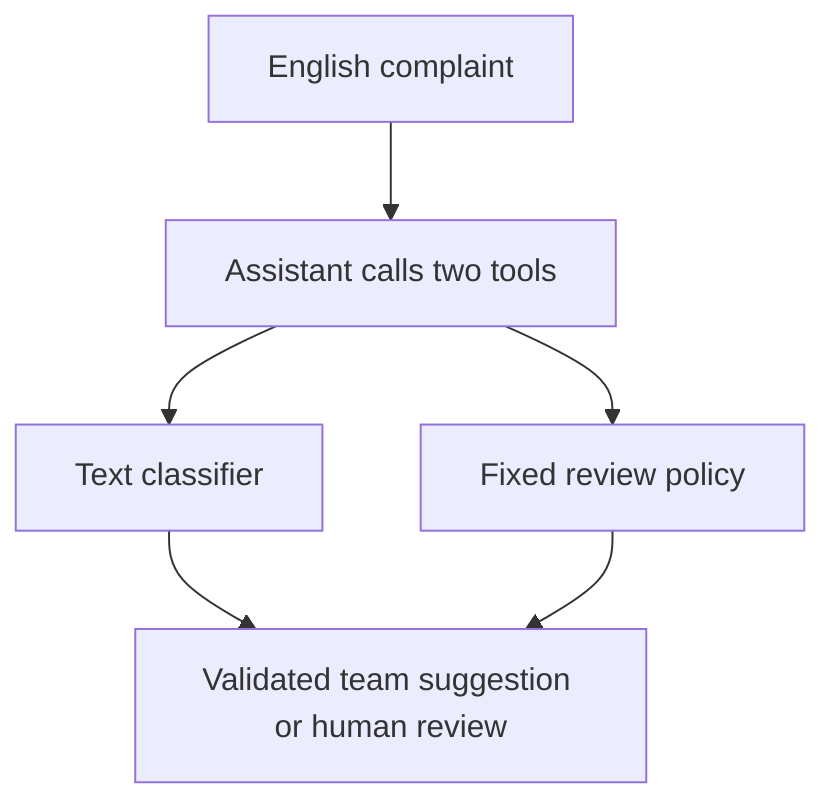

# Complaint Review Assistant
### When should an AI assistant ask for human review?

A small pre-graduate-study exploration by Juhan Youn: use complaint text to suggest a product support team, while leaving uncertain cases for a person.

**Current status:** real public data, classifier, Python review rules and local app evaluated. The real LLM tool-calling implementation is ready for a paid smoke test; **agent evaluation pending**. No LLM performance is claimed.

## What the comparison found

On **1,022 complaints received in May–June 2024**:

| Method | Team suggestions | Human review | Error among suggestions | Wrong suggestions / all cases |
|---|---:|---:|---:|---:|
| Classifier only | 100% | 0% | 13.7% (140/1,022) | 13.7% |
| Classifier + Python review rules | 85.8% | 14.2% | 7.2% (63/877) | 6.2% |
| Real LLM assistant | Pending | Pending | Pending | Pending |

The rules deferred **77 of the classifier's 140 errors (55.0%)**. Deferring a case does not mean that a person corrected it. These are disagreements with public product labels, which are imperfect proxies for appropriate business routing.

**My question for further study:** How should the boundary change when the cost of a wrong suggestion and the capacity of human reviewers are known?

## What it does

- TF-IDF + logistic regression learns four product categories from complaint text only.
- Fixed review rules handle invalid inputs or closely competing model scores.
- A bounded LLM assistant calls `classify_complaint` and `get_review_policy`, then returns a structured routing suggestion or `HUMAN_REVIEW`.
- The same-rule Python baseline makes clear that this boundary decision does not require an LLM.



The assistant chooses tool order and explains results. It cannot rewrite the input, change the policy, invent a team or take external action. It is a deliberately narrow agent, not a general chatbot.

## Run locally — Windows PowerShell

Extract the project and open its folder in VS Code. Use Python 3.11 or newer. Enter these commands separately:

```powershell
python -m venv .venv
```
```powershell
.\.venv\Scripts\Activate.ps1
```
```powershell
python -m pip install -e ".[dev]"
```
```powershell
python -m cra.cli prepare
```
```powershell
python -m cra.cli train
```
```powershell
python -m pytest -q
```
```powershell
python -m streamlit run app/streamlit_app.py
```

Open the Local URL printed by Streamlit. The terminal stays occupied while the app runs; press Ctrl+C to stop. If activation is blocked, select `.venv` through VS Code's **Python: Select Interpreter**, open a new terminal, and confirm `python -c "import sys; print(sys.executable)"` points to `.venv`. Do not change machine-wide security settings.

Preparation downloads **two official date archives, about 178 MB total**, because the current CFPB API no longer supplies narratives. It keeps only a small sample locally. First-time cleaning can take several minutes. See [methodology](docs/methodology.md) for source links and exact criteria. No API key is needed for these steps.

## Explore the evidence

- [Short findings report](docs/results.md)
- [Data, frozen protocol and evaluation definitions](docs/methodology.md)
- [Optional real API evaluation and cost preview](docs/api_run.md)
- [Code tour and learning checklist (Korean)](docs/learning_ko.md)
- [GitHub setup](docs/github_setup.md)
- [Machine-readable aggregates](docs/evidence/summary.json)

No real replies, financial advice, urgency assessment or complaint submissions. Team names are project-defined examples. No measured time saving, customer satisfaction improvement or operational cost saving is claimed.

## Authorship and learning

Implementation, tests and initial documentation were developed with AI assistance. Juhan selected the question and scope with that support. Personal interpretations and learning statements remain drafts for Juhan to review and explain in his own words; this repository does not imply independently authored code or an employed data-scientist role.

Results shown above use Juhan's October 29 Windows reproduction. Identical data and review thresholds produced slightly different predictions with different library versions. The [initial run](docs/evidence/initial_run_2026-10-27.json) is retained; see the [reproduction note](docs/results.md#local-reproduction--october-29-2026).
